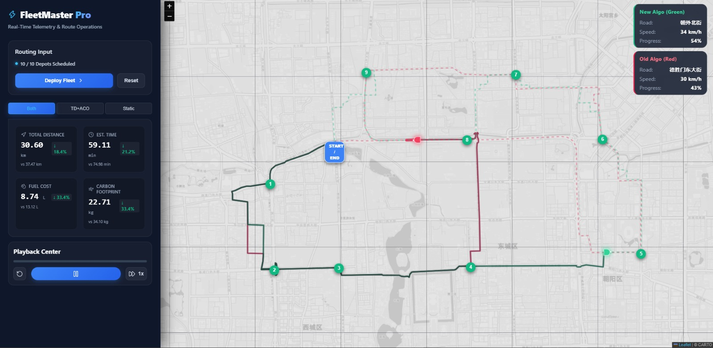

# GNN-Enhanced ACO for Dynamic and Green Multi-Depot Vehicle Routing in Smart Cities

**DeepACO-Enhanced IM-VRM** — a data-driven routing framework that plans multi-depot delivery routes around predicted traffic congestion while minimising fuel use and CO₂ emissions. Built on 15M+ real GPS points from 10,357 Beijing taxis (Microsoft T-Drive).

B.Tech Project · **ABV-IIITM Gwalior** · Supervised by **Dr. Bhanu Chander**

🌐 **Live demo:** [fleetmaster-api.vercel.app](https://fleetmaster-api.vercel.app/) — interactive web app (code in [td-dijkstra-aco-router](https://github.com/psp2535/td-dijkstra-aco-router))

---

## 👥 Team

| | Name | GitHub | LinkedIn |
|:-:|---|---|---|
|  | **Pathange Sai Pranav** | [@psp2535](https://github.com/psp2535) | [pathangesaipranav](https://www.linkedin.com/in/pathangesaipranav/) |
|  | **Chakali Surendra** | [@suri5790](https://github.com/suri5790) | [surendrachakali](https://www.linkedin.com/in/surendrachakali/) |
|  | **Duppala Satwik** | [@Satwik2529](https://github.com/Satwik2529) | [satwik2529dsk](https://www.linkedin.com/in/satwik2529dsk/) |

**Supervisor:** Dr. Bhanu Chander, ABV-IIITM Gwalior

---

## 📌 Overview

Classical routing heuristics such as Ant Colony Optimization (ACO) steer by static distance (`1/d`), so they cannot see traffic building up and produce slow, fuel-hungry routes. This project extends the **IM-VRM** model (*IEEE T-ITS, Vol. 26, Issue 6, June 2025*) with three learned components:

| Module | What it does | Model |
|---|---|---|
| **GNN Spatial Embedder** | Learns 64-dim embeddings of Beijing's road-transition graph, capturing multi-hop connectivity rather than straight-line distance | 2-layer GCN, self-supervised distance-reconstruction loss |
| **TCFMu** (Traffic Congestion Forecasting) | Predicts the congestion level (FreeFlow / Moderate / Congested) of each grid cell per hour | XGBoost classifier — **91.4% accuracy**, macro-F1 0.892 |
| **DeepACO** | Replaces ACO's hand-made `1/d` heuristic with a neural policy scoring each move from a 137-dim state (GNN embeddings + edge traffic/fuel features + vehicle profile) | MLP trained with REINFORCE policy gradients |

Routes are optimised for a **green logistics cost** combining distance, travel time, congestion, and a load- and speed-dependent fuel/CO₂ model.

---

## 📊 Results

Evaluated on 300-taxi fleet configurations across Beijing, mean ± std over 5 random seeds (from the project paper, `IM-VRM_Paper.tex`):

| Algorithm | Distance (km) | Duration (s) | Fuel (L) | CO₂ (g) | Inference (s/vehicle) |
|---|---|---|---|---|---|
| Greedy (baseline) | 221.87 | 12,259 | 34.27 | 85,049 | 0.018 |
| Classical ACO | 186.25 ± 1.4 | 10,768 ± 85 | 27.87 ± 0.4 | 69,117 ± 950 | 0.653 ± 0.012 |
| **DeepACO (ours)** | **183.15 ± 1.9** | **10,240 ± 92** | **26.50 ± 0.5** | **65,420 ± 1,100** | **0.606 ± 0.008** |

- **23.0% less CO₂** than the greedy baseline, and **5.3% less** than tuned classical ACO
- **75% fewer iterations** to converge (25 vs 100), since the learned heuristic skips blind exploration
- **7.2% lower** per-vehicle inference latency than classical ACO
- Improvement over classical ACO is statistically significant (Wilcoxon signed-rank, p < 0.05)



---

## 🚀 Getting Started

**Requirements:** Python 3.10+ (tested on 3.14). The T-Drive dataset is already included in `release/taxi_log_2008_by_id/`.

```bash
git clone https://github.com/psp2535/BTP-Project.git
cd BTP-Project

python -m venv .venv
# Windows: .venv\Scripts\activate    macOS/Linux: source .venv/bin/activate
pip install -r requirements.txt
```

### Run the full pipeline

```bash
python main.py --step all --num-taxis 50      # use -1 for all 10,357 taxis
```

Processed data goes to `data/processed/`, results and plots to `outputs/`. A 50-taxi run takes about 2 minutes on a laptop CPU; 1,000+ taxis can take an hour or more.

### Run a single step

`main.py --step <name>` runs one stage of the 11-step pipeline:

| # | Step | What it does |
|:-:|---|---|
| 1 | `preprocess` | Clean GPS logs, split into trips, compute speed/acceleration and fuel/CO₂ |
| 2 | `congestion` | Label each grid cell's hourly congestion level |
| 3 | `graph` | Build the 30×30 grid transition graph |
| 4 | `fleet` | Generate a synthetic multi-depot vehicle fleet |
| 5 | `gnn_prep` | Prepare graph tensors for PyTorch |
| 6 | `gnn_embed` | Train the GCN and export 64-dim node embeddings |
| 7 | `greedy_route` | Greedy baseline routing |
| 8 | `tcfmu` | Train the XGBoost congestion forecaster |
| 9 | `route_opt` | Time-dependent Dijkstra routing |
| 10 | `aco_route` | Classical ACO routing |
| 11 | `deep_aco` | Train DeepACO and compare all algorithms |

Later steps read the outputs of earlier ones, so run `--step all` once before running steps individually.

### Interactive dashboard

```bash
streamlit run interactive_simulation.py
```

Explore how vehicle type, payload and speed change fuel use and CO₂ for each algorithm, using the results in `outputs/deep_aco_comparison.csv`.

### Verify

Each `verify_*.py` script runs part of the pipeline and checks its outputs:

```bash
python verify_pipeline.py          # quick: 5 taxis, all steps
python verify_tcfmu.py             # XGBoost forecaster
python verify_aco.py               # classical ACO (300 taxis)
python verify_deep_aco.py          # DeepACO (1000 taxis — slow, an hour or more on CPU)
python verify_paper_integrity.py   # LaTeX labels, refs and citations
```

---

## 📁 Repository Structure

```
BTP-Project/
├── main.py                      # 11-step pipeline entry point
├── config/default_config.yaml   # Bounding box, grid size, thresholds, vehicle parameters
├── src/
│   ├── preprocessing/           # GPS cleaning and trip segmentation
│   ├── features/                # Kinematics, fuel/CO₂ model, spatial grid, synthetic fleet
│   ├── graph/                   # Grid transition graph and GNN features
│   ├── models/                  # GNN, TCFMu (XGBoost), greedy, Dijkstra, ACO, DeepACO
│   └── utils/                   # Helpers and visualisation
├── interactive_simulation.py    # Streamlit dashboard
├── verify_*.py                  # Verification scripts
├── notebooks/                   # Data exploration and grid analysis
├── research/                    # Extra experiments (scalability, sensitivity), review notes
├── IM-VRM_Paper.tex             # Project paper (IEEE format)
├── generate_*.py, *.png         # Architecture diagrams and figures
├── release/taxi_log_2008_by_id/ # Microsoft T-Drive dataset
└── outputs/                     # Generated results
```

<details>
<summary><b>📖 Model details: kinematics, fuel model and congestion labels</b></summary>

### Kinematics
For consecutive GPS points, distance uses the Haversine formula (R = 6,371 km), speed is `v = Δd / Δt`, and acceleration is `a = Δv / Δt`. Points implying speeds above 120 km/h are dropped as GPS errors, and a gap of over 20 minutes starts a new trip.

### Green fuel and emission model
- **Payload correction:** `F_adj = F_base × (1 + λ_load × payload_kg / 100)`
- **Speed efficiency multiplier η(v)**, U-shaped: 2.0 below 10 km/h (crawl) · 1.4 for 10–30 · **1.0 for 30–60 (optimal)** · 1.25 for 60–90 · 1.6 above 90 (drag)
- **Fuel per step (L):** `F_adj / 100 × distance_km × η(v)`; idling burns a fixed rate (1.2 L/h light, 3.5 L/h heavy)
- **CO₂ (g):** `fuel × CO₂ per litre` (2,300 g/L light-duty, 2,600 g/L heavy-duty)

### Congestion labels
Beijing is split into a 30×30 grid. Each cell's free-flow speed is the 90th percentile of its observed speeds, and its hourly congestion ratio is `R = V_avg(h) / V_ff`:
- **Level 0 — FreeFlow:** R ≥ 0.7
- **Level 1 — Moderate:** 0.4 ≤ R < 0.7
- **Level 2 — Congested:** R < 0.4

### Transition graph
Nodes are visited grid cells; a directed edge links two cells when a taxi actually moves between them in consecutive GPS points, weighted by transition count and average speed.

</details>

---

## 📚 References

- **Base model:** *"An Intelligent Multi-Depot Vehicle Routing and Management Model for Smart Cities,"* IEEE Transactions on Intelligent Transportation Systems, Vol. 26, Issue 6, June 2025.
- **Dataset:** [Microsoft T-Drive Taxi Trajectories](https://www.microsoft.com/en-us/research/publication/t-drive-trajectory-data-sample/) — one week of GPS data from 10,357 Beijing taxis.
